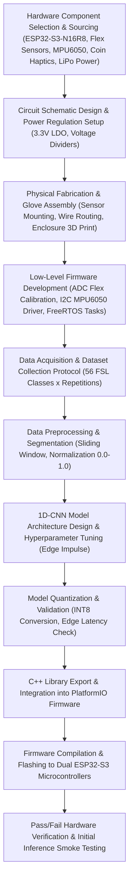
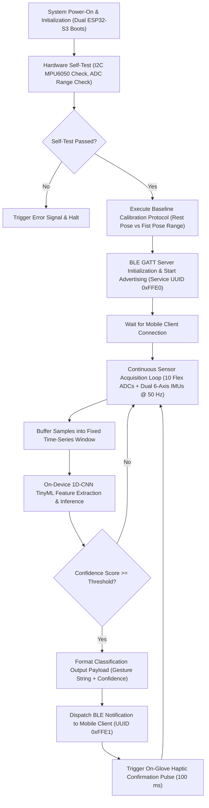
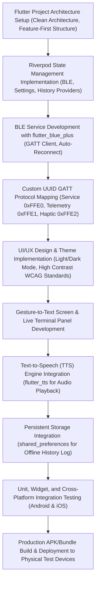
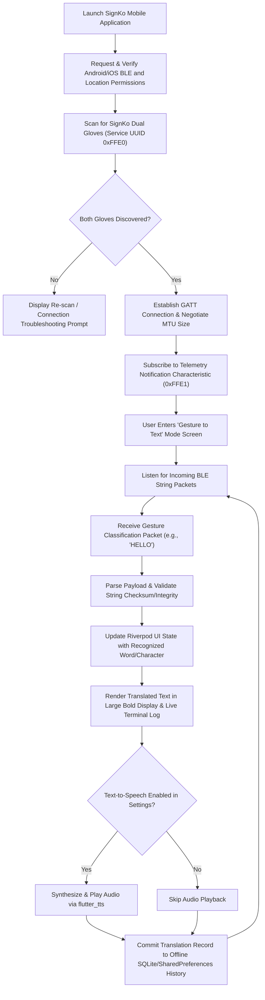
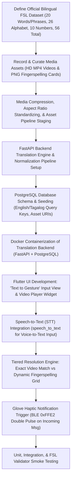
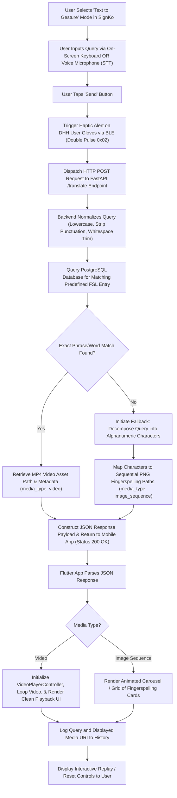
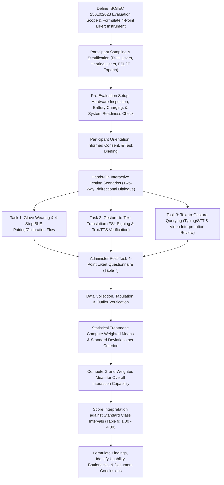

# Research Methodology: Flowcharts and Step-by-Step Procedures

This document provides the complete structural flowcharts and step-by-step procedures for the four research objectives of the **SignKo** bidirectional Filipino Sign Language (FSL) translation system, formulated in accordance with the panel's recommendations.

---

## Objective 1: Dual Wearable Sensor Gloves and Gesture Recognition

> **Research Objective 1:** To design dual wearable sensor gloves using flex sensors and MPU6050 inertial measurement units (IMUs), integrated with a 1D Convolutional Neural Network (1D-CNN), to recognize predefined Filipino Sign Language (FSL) gestures and translate them into text.

### Flowchart 1A: Hardware and Software Development and Implementation

### Flowchart 1B: Operational Process of the Dual Wearable Sensor Gloves

### Numbered Description of Procedures for Objective 1

#### 1. Development and Implementation Procedures
1. **Component Procurement and Hardware Sourcing:** Procure two ESP32-S3-N16R8 microcontrollers (dual-core Xtensa, 16 MB Flash, 8 MB Octal PSRAM), ten bidirectional 2.2-inch resistive flex sensors, two 6-axis MPU6050 IMU modules (3-axis accelerometer and 3-axis gyroscope), two 3V coin vibration motors, N-channel MOSFET drivers, 3.7V 1200 mAh LiPo batteries, and TP4056 charging modules with power regulation circuitry.
2. **Circuit Schematic and Breadboard Prototyping:** Design dedicated voltage divider circuits for each flex sensor using precision $10\text{ k}\Omega$ metal film resistors connected to low-noise ADC1 pins of the ESP32-S3 to avoid ADC2 conflicts with active Wi-Fi/Bluetooth. Wire the MPU6050 modules via the primary I2C bus (SDA: GPIO 8, SCL: GPIO 9). Wire the coin vibration motors to digital GPIOs through transistor switching circuits.
3. **Physical Glove Fabrication and Ergonomic Assembly:** Mount five flex sensors along the dorsal aspect of each glove finger (thumb, index, middle, ring, pinky) using flexible silicone guide channels to prevent sensor twisting. Secure the MPU6050 module flat against the metacarpal region of the dorsal hand to track spatial orientation ($roll, pitch, yaw$). Secure the ESP32-S3 and power module within a lightweight 3D-printed wrist enclosure.
4. **Firmware Architecture and Driver Implementation:** Implement non-blocking firmware in PlatformIO using FreeRTOS. Configure two concurrent tasks: Core 0 dedicated to BLE GATT advertising and communication; Core 1 dedicated to high-speed sensor sampling ($50\text{ Hz}$), signal filtering, and neural network inference.
5. **FSL Gesture Dataset Collection:** Execute a standardized data collection protocol across 56 predefined FSL classes: 26 alphabet letters ($A\text{ to }Z$), 10 numbers ($1\text{ to }10$), and 20 bilingual words/phrases. Collect raw time-series data streams (flex sensor ADC levels and calibrated acceleration/angular velocity vectors).
6. **Data Preprocessing and Augmentation:** Apply rolling average smoothing and min-max feature scaling to normalize flex values into a $[0.0, 1.0]$ floating-point range. Segment dynamic gestures into fixed temporal frames (1000 ms sliding window with 50% overlap).
7. **1D-CNN Model Architecture and Edge Impulse Training:** Construct a 1D Convolutional Neural Network consisting of:
   - Input layer matching sensor feature channels (10 flex + 12 IMU axes).
   - Two 1D convolutional layers with ReLU activation for temporal pattern extraction.
   - 1D max-pooling and spatial dropout layers ($p = 0.2$) to prevent overfitting.
   - Fully connected dense layer leading to a 56-class Softmax classification layer.
8. **Quantization and Firmware Embedding:** Quantize the trained 1D-CNN model from 32-bit floating-point (FP32) to 8-bit integer (INT8) representation using TensorFlow Lite for Microcontrollers. Export the optimized C++ inference library from Edge Impulse and link it directly into the PlatformIO firmware project.
9. **Flashing and Validation:** Compile the integrated firmware and flash both left and right ESP32-S3 boards via USB-C. Verify that inference latency runs well under $100\text{ ms}$ on-device.

#### 2. Operational Procedures
1. **Power-Up:** The user powers on the dual sensor gloves using the wrist-mounted toggle switches.
2. **Boot Diagnostics:** Firmware initializes system buses, verifies I2C communication with the MPU6050, and checks battery voltage.
3. **Rest-Pose Calibration:** The user holds their hands open and flat (Rest Pose) for 3 seconds to establish the baseline minimum flex sensor readings ($ADC_{min}$), followed by a closed fist (Fist Pose) for 3 seconds to establish maximum curvature ($ADC_{max}$).
4. **BLE Advertising:** The dual gloves begin BLE GATT server advertising with service UUID `0000ffe0-0000-1000-8000-00805f9b34fb`.
5. **Continuous Gesture Sampling:** Once connected to the mobile app, sensor streams are collected into sliding time-series windows.
6. **On-Device Inference:** The 1D-CNN engine processes the active window. When a recognized class exceeds the defined confidence threshold ($\ge 0.80$), the recognized class label is committed.
7. **Wireless Transmission and Haptic Confirmation:** The ESP32 sends the classified gesture string over characteristic `0000ffe1-0000-1000-8000-00805f9b34fb` to the mobile phone and triggers a 100 ms haptic pulse (`HAPTIC_SHORT_PULSE`) to alert the signer that the gesture was recorded.

#### 3. Testing Procedures
1. **Hardware Pass/Fail Inspection:** Verify each hardware module against five functional criteria:
   - Flex sensor resistance change under full bend ($\Delta R \ge 15\text{ k}\Omega$).
   - MPU6050 I2C ACK response and zero-drift calibration.
   - Battery voltage regulation stability ($3.3\text{V} \pm 0.05\text{V}$).
   - BLE advertisement packet broadcast.
   - Haptic vibration activation on GPIO command.
2. **Gesture Recognition Experimental Trials:** Conduct 1,680 total trials across all 56 predefined FSL classes ($56\text{ gestures} \times 30\text{ trials/gesture} = 1,680\text{ trials}$). Record predicted class output against ground-truth labels.

#### 4. Measurements and Indicators
1. **Confusion Matrix Parameters:** Log True Positives ($TP$), False Positives ($FP$), True Negatives ($TN$), and False Negatives ($FN$) for each gesture class using a One-vs-Rest (OvR) approach.
2. **Macro-Averaged Precision, Recall, and F1-Score:**
   $$\text{Precision} = \frac{TP}{TP + FP}, \quad \text{Recall} = \frac{TP}{TP + FN}, \quad \text{F1-Score} = 2 \times \frac{\text{Precision} \times \text{Recall}}{\text{Precision} + \text{Recall}}$$
3. **Overall Multi-Class Accuracy:**
   $$\text{Overall Accuracy} = \frac{\sum_{i=1}^{56} TP_i}{1,680} \times 100\%$$

#### 5. Evaluation Criteria
- **$\ge 95.00\%$:** Very High Accuracy
- **$90.00\% \le \text{Accuracy} < 95.00\%$:** High Accuracy
- **$85.00\% \le \text{Accuracy} < 90.00\%$:** Moderate Accuracy
- **$< 85.00\%$:** Poor Accuracy

---

## Objective 2: Mobile Application for Gesture-to-Text Communication

> **Research Objective 2:** To develop a Flutter-based mobile application using Bluetooth Low Energy (BLE) communication to receive and display the translated text output from the dual wearable sensor gloves.

### Flowchart 2A: Mobile Application Development and BLE Integration

### Flowchart 2B: Operational Process of Receiving and Displaying Translated Text

### Numbered Description of Procedures for Objective 2

#### 1. Development and Implementation Procedures
1. **Framework and Architecture Setup:** Initialize the Flutter mobile application adhering to a feature-first clean architecture separating presentation, domain, and data layers.
2. **State Management Integration:** Implement Riverpod (`flutter_riverpod`) to govern application state, managing asynchronous streams from Bluetooth, user preference mutations, and background history storage.
3. **BLE Client Layer Development:** Utilize `flutter_blue_plus` to implement a GATT client service capable of concurrent, dual-peripheral connection handling (left glove and right glove). Configure automated reconnection handlers upon connection loss.
4. **GATT Protocol Mapping:** Bind the mobile client to the predefined SignKo GATT schema:
   - Primary Service: `0000ffe0-0000-1000-8000-00805f9b34fb`
   - Telemetry/Classification RX: `0000ffe1-0000-1000-8000-00805f9b34fb` (Notify)
   - Glove Haptic Feedback TX: `0000ffe2-0000-1000-8000-00805f9b34fb` (Write)
5. **UI Screen and Widget Design:** Build the **Gesture to Text** view featuring large typography display cards, real-time confidence rating meters, live classification terminal panels, and intuitive connection status indicators. Implement dual Light/Dark themes using Google Fonts (Nunito).
6. **Text-to-Speech (TTS) Integration:** Integrate `flutter_tts` to immediately synthesize received translated text into audible spoken English or Filipino, enabling auditory reception by non-signing hearing users.
7. **Offline History Persistence:** Implement local caching using `shared_preferences` to persist timestamped conversation records, allowing users to review, search, and clear prior translations offline.

#### 2. Operational Procedures
1. **Application Launch and Permission Check:** The user launches SignKo. The app checks Bluetooth and Location permissions, requesting authorization if not previously granted.
2. **Device Discovery and Connection:** The app scans for advertising ESP32 devices matching the SignKo service UUID. Upon discovery, it automatically pairs with both gloves and negotiates MTU size.
3. **Telemetry Subscription:** The app subscribes to the notification stream on characteristic `0xFFE1`.
4. **Packet Arrival and Parsing:** When a classification packet arrives, the BLE service extracts the payload, strips delimiters, and updates the application state.
5. **Visual Display Rendering:** The text appears on screen with smooth transition animations.
6. **Multimodal Output Execution:** If enabled in settings, the application invokes the TTS engine to vocalize the text. Simultaneously, the entry is logged to the conversation history database.

#### 3. Testing Procedures
1. **BLE Transmission Range and Packet Delivery Testing:** Place the ESP32 gloves at fixed distances of $0.5\text{ m}$, $1.0\text{ m}$, and $3.0\text{ m}$ from the mobile smartphone. Transmit 500 continuous classification packets per distance. Record the count of packets successfully parsed by the phone versus total packets sent.
2. **Text Display Accuracy (TDA) Verification:** Cross-examine the character string displayed on the mobile screen against the serial log of transmitted strings from the ESP32 over 280 trials.
3. **Application Response Time ($T$) Latency Benchmarking:** Log high-precision hardware timestamps from the receipt of the BLE notification callback (`onValueReceived`) to the completion of the widget repaint callback (`addPostFrameCallback`).

#### 4. Measurements and Indicators
1. **BLE Packet Delivery Ratio (PDR):**
   $$\text{PDR} = \frac{\text{Packets Received by Mobile App}}{\text{Packets Transmitted by Gloves}} \times 100\%$$
2. **Text Display Accuracy (TDA):**
   $$\text{TDA} = \frac{\text{Correctly Displayed Output Strings}}{\text{Total Received Classification Packets}} \times 100\%$$
3. **Application Response Time ($T$):**
   $$T = t_{\text{UI Render Complete}} - t_{\text{BLE Packet Arrival}} \quad (\text{measured in milliseconds})$$

#### 5. Evaluation Criteria
- **PDR and TDA Ranges:**
  - **$\ge 98.00\%$:** Excellent
  - **$95.00\% \le x < 98.00\%$:** Good
  - **$90.00\% \le x < 95.00\%$:** Fair
  - **$< 90.00\%$:** Poor
- **Application Response Time ($T$) Ranges:**
  - **$T \le 150\text{ ms}$:** Excellent
  - **$150\text{ ms} < T \le 1,000\text{ ms}$:** Good
  - **$1,000\text{ ms} < T \le 2,000\text{ ms}$:** Fair
  - **$T > 2,000\text{ ms}$:** Poor

---

## Objective 3: Mobile Application Feature for Text-to-FSL Translation

> **Research Objective 3:** To develop a Flutter-based mobile application feature that converts typed text input into Filipino Sign Language (FSL) through the retrieval and presentation of predefined FSL images/videos using a virtual sign language interpreter.

### Flowchart 3A: Development and Implementation of the Text-to-FSL Feature

### Flowchart 3B: Operational Process of Text Input and FSL Image/Video Retrieval

### Numbered Description of Procedures for Objective 3

#### 1. Development and Implementation Procedures
1. **Bilingual Vocabulary Dataset Definition:** Formalize the 56-item bilingual FSL dataset comprising 20 conversational words/phrases with dual English and Filipino/Tagalog keys, 26 alphabet fingerspelling characters, and 10 numerical signs.
2. **Media Asset Production:** Record high-definition demonstration videos ($1080\text{p}$, $60\text{ fps}$) performed by a fluent FSL signer under controlled lighting. Format clips as standardized `.mp4` video files. Curate static fingerspelling illustrations formatted as transparent `.png` character cards.
3. **Database Architecture and Seeding:** Build a PostgreSQL relational database storing normalized search tokens, exact query keys, Filipino synonyms, media types (`video` or `image_sequence`), and localized asset paths.
4. **FastAPI Backend Services:** Implement high-performance asynchronous API endpoints using FastAPI. Construct query normalization logic capable of handling punctuation variations, contractions, and space-condensed words (e.g., matching "Thank you", "thankyou", and "salamat").
5. **Containerization and Local Cloud Staging:** Dockerize the backend using `docker-compose.yml` orchestrating FastAPI and PostgreSQL services for seamless offline or local network hosting.
6. **Mobile Presentation Layer:** Build the Flutter `TextToSignPanel` incorporating `video_player` for hardware-accelerated video playback and dynamic character card carousels. Include speech-to-text voice dictation using `speech_to_text`.
7. **Glove Alert Cross-Trigger:** Wire the text transmission trigger to dispatch a `HAPTIC_DOUBLE_PULSE` (`0x02`) command to the gloves via BLE characteristic `0xFFE2`, physically notifying the DHH user that a hearing participant has sent a message.

#### 2. Operational Procedures
1. **Query Entry:** A non-signing hearing individual opens the **Text to Gesture** tab, typing a phrase into the input field or holding the microphone icon to transcribe spoken voice.
2. **Submission:** Upon tapping Send, the keyboard dismisses, and a loading shimmer activates.
3. **Glove Haptic Signaling:** The app immediately transmits a haptic command to the paired gloves, vibrating the user's wrist with two short pulses to command visual attention.
4. **Resolution:** The mobile client queries `POST /translate`. The backend parses the query:
   - If an exact phrase match exists in the database, the backend returns the video asset URI (`assets/videos/{slug}.mp4`).
   - If an unindexed word is submitted, the backend breaks the word into characters and returns an ordered array of fingerspelling card paths (`assets/images/alphabet/{char}.png`).
5. **Rendering:** The Flutter client loads the asset, rendering full-screen looping video playback or an interactive horizontal character card sequence.
6. **Replay Control:** The user can tap replay, inspect individual characters, or clear the screen for subsequent queries.

#### 3. Testing Procedures
1. **Query Response Time (QRT) Measurement:** Execute 280 test trials (56 vocabulary entries across 5 repeated trials each). Measure elapsed wall-clock time from the HTTP POST dispatch to the first frame rendered by the video player or card grid.
2. **FSL Translation Output Accuracy (FSL-TOA) Verification:** Present all 280 rendered outputs to a certified, independent FSL interpreter. The validator confirms whether the gesture shown accurately conveys the linguistic and semantic meaning of the typed query ($Pass = 1, Fail = 0$).
3. **Image/Video Retrieval Success Rate (IVRSR) Evaluation:** Check whether the designated asset was successfully located, loaded, and displayed without network timeout, broken path, or black-screen rendering error.

#### 4. Measurements and Indicators
1. **Average Query Response Time ($\overline{QRT}$):**
   $$\overline{QRT} = \frac{\sum_{i=1}^{280} QRT_i}{280} \quad (\text{measured in seconds})$$
2. **FSL Translation Output Accuracy (FSL-TOA):**
   $$\text{FSL-TOA} = \frac{N_c}{280} \times 100\% \quad (\text{where } N_c = \text{interpreter-validated correct outputs})$$
3. **Image/Video Retrieval Success Rate (IVRSR):**
   $$\text{IVRSR} = \frac{N_s}{280} \times 100\% \quad (\text{where } N_s = \text{successfully loaded and displayed assets})$$

#### 5. Evaluation Criteria
- **Query Response Time ($\overline{QRT}$):**
  - **$\overline{QRT} \le 2.0\text{ seconds}$:** Meets Benchmark
  - **$\overline{QRT} > 2.0\text{ seconds}$:** Below Benchmark
- **FSL Translation Output Accuracy (FSL-TOA):**
  - **$100.00\%$:** Excellent
  - **$90.00\% \le \text{FSL-TOA} < 100.00\%$:** Meets Benchmark
  - **$< 90.00\%$:** Below Benchmark
- **Image/Video Retrieval Success Rate (IVRSR):**
  - **$\ge 84.00\%$:** Meets/Exceeds Published Benchmark
  - **$< 84.00\%$:** Below Benchmark

---

## Objective 4: Evaluation of the Developed SignKo System

> **Research Objective 4:** To evaluate the developed portable two-way Filipino Sign Language (FSL) communication system in accordance with ISO/IEC 25010:2023, specifically in terms of:
> - 4.1. Appropriateness Recognizability
> - 4.2. Learnability
> - 4.3. Operability
> - 4.4. Inclusivity

### Flowchart 4: System Evaluation Process

### Numbered Description of Procedures for Objective 4

#### 1. Evaluation Procedures and Participant Stratification
1. **Instrument Formulation:** Construct an evaluation questionnaire based on the **ISO/IEC 25010:2023 Interaction Capability** quality model. Formulate specific indicator statements evaluating:
   - **Appropriateness Recognizability:** Understanding system purpose, interface clarity, and mode visibility.
   - **Learnability:** Ease of mastering glove calibration, signing feedback, and virtual interpreter interpretation.
   - **Operability:** Glove physical comfort, tactile feedback responsiveness, mobile navigation, and error recovery.
   - **Inclusivity:** Multimodal accessibility (visual, haptic, auditory), bilingual support, and adaptability to varied hand dimensions.
2. **Participant Sampling and Stratification:** Recruit participants stratified across three key respondent groups:
   - Deaf and Hard-of-Hearing (DHH) individuals who are primary FSL signers.
   - Non-signing hearing individuals representing general conversational partners.
   - Subject matter experts comprising licensed FSL educators/interpreters and embedded/software engineers.
3. **Orientation and Ethical Consent:** Secure informed consent from all participants. For DHH participants, ensure instructions and consent documentation are delivered with a certified FSL interpreter present.
4. **Hands-On Task Execution:** Guide each participant through three practical conversational tasks:
   - *Task 1:* Donning the gloves, completing the 4-step BLE pairing, and performing baseline Rest/Fist calibration.
   - *Task 2:* Performing 5 predefined FSL gestures in Gesture-to-Text mode, verifying visual text and TTS output.
   - *Task 3:* Typing and speaking 5 phrases in Text-to-Gesture mode, verifying glove vibration alerts and video playback.

#### 2. Questionnaire Administration
1. **Scoring Scale:** Administer the survey using an even, **4-point forced-choice Likert scale** (Table 7). Removing the neutral midpoint eliminates central tendency bias, requiring respondents to express a definitive evaluation.
2. **Rating Schema (Table 7):**
   - **4 — Strongly Agree (SA):** Excellent (Weighted Mean Range: $3.25\text{–}4.00$)
   - **3 — Agree (A):** Good (Weighted Mean Range: $2.50\text{–}3.24$)
   - **2 — Disagree (D):** Fair (Weighted Mean Range: $1.75\text{–}2.49$)
   - **1 — Strongly Disagree (SD):** Poor (Weighted Mean Range: $1.00\text{–}1.74$)

#### 3. Statistical Treatment and Computation
1. **Weighted Mean ($\overline{x}$) Computation:** For each indicator item $j$ within a subcharacteristic, calculate the weighted mean:
   $$\overline{x}_j = \frac{\sum_{i=1}^{4} (f_i \times w_i)}{N}$$
   *(where $f_i$ is response frequency for weight $w_i \in \{1, 2, 3, 4\}$, and $N$ is total respondents).*
2. **Subcharacteristic Mean:** Compute the aggregate mean score for each of the four ISO/IEC subcharacteristics:
   $$\overline{X}_{\text{sub}} = \frac{1}{k} \sum_{j=1}^{k} \overline{x}_j$$
   *(where $k$ is the number of indicator questions under that subcharacteristic).*
3. **Standard Deviation ($SD$):** Compute the sample standard deviation for each category to evaluate response consensus:
   $$SD = \sqrt{\frac{\sum_{i=1}^{N} (x_i - \overline{x})^2}{N - 1}}$$
4. **Overall Interaction Capability Score:** Calculate the grand weighted mean across all four subcharacteristics:
   $$\overline{X}_{\text{overall}} = \frac{\overline{X}_{\text{AR}} + \overline{X}_{\text{L}} + \overline{X}_{\text{O}} + \overline{X}_{\text{I}}}{4}$$

#### 4. Interpretation of Results
1. **Performance Evaluation Ranges (Table 9):**
   Interpret the resulting weighted means across all individual subcharacteristics and the Overall Interaction Capability using uniform $0.75$ interval widths:
   - **$3.25 \le \overline{x} \le 4.00$:** **Excellent** — The system demonstrates superior interaction capability, requiring no structural modifications.
   - **$2.50 \le \overline{x} \le 3.24$:** **Good** — The system meets acceptable usability and accessibility standards with minor non-blocking refinement opportunities.
   - **$1.75 \le \overline{x} \le 2.49$:** **Fair** — The system exhibits noticeable interaction barriers that require targeted ergonomic or software improvements.
   - **$1.00 \le \overline{x} \le 1.74$:** **Poor** — The system fails to meet core usability requirements, necessitating fundamental redesign.
2. **Analysis and Synthesis:** Synthesize quantitative scores with qualitative user comments to highlight specific strengths (e.g., haptic feedback utility) and actionable improvement points (e.g., flex sensor enclosure flexibility).
